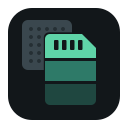

# Roxora Imager



A desktop app that installs [Roxora](https://github.com/roxora-os/build)
images in two ways:

- **SD card or USB drive.** Downloads the image from a Roxora release, checks
  it against the release SHA-256, writes it, then reads the drive back and
  compares it with the release.
- **Board storage over USB (Maskrom).** Writes a board's eMMC or SPI NOR
  flash through its USB-C port, with the same read-back check.

The same page also runs in the browser, Maskrom only, at
https://roxora-os.github.io/imager/ (Chrome, Edge or another browser with
WebUSB). A browser cannot open a disk, so it cannot write an SD card in the
computer.

GitHub serves release downloads without CORS headers, so a web page cannot
download them itself. The web version therefore gets release files in one of
two ways:

- **Through the download proxy**, when the build has one: a small Cloudflare
  Worker ([worker/](worker/)) that serves only the release files with CORS
  headers. The page downloads the file showing progress, checks its size
  and SHA-256 against the catalog (whose checksums were compared with the
  digests the GitHub API publishes) while it streams, then writes it and
  reads it back against `extract_sha256`.
- **By hand**, when there is no proxy or it fails: the page says why, the
  release file is downloaded in the browser, picked, and checked the same way
  before it is written.

The proxy address is set at build time with `ROXORA_DOWNLOAD_PROXY` (the
Pages workflow takes it from the repository variable of the same name). It is
empty until the Worker is deployed. The desktop app downloads directly and
does not use it.

Status: first version, not yet tested on hardware. It lists the Roxora
pre-releases, which are built and checked in CI but not yet booted on
hardware either.

## Install

Windows (x64), macOS (Apple silicon and Intel) and Linux (AppImage, .deb,
.rpm; x86_64 and arm64) packages are attached to the
[releases](https://github.com/roxora-os/imager/releases) once there is one;
until then build it from source as below. On macOS and Linux:

```sh
curl -fsSL https://raw.githubusercontent.com/roxora-os/imager/main/install.sh | sh
```

What each system asks on first start, and the drivers for Maskrom writing:
[docs/install.md](docs/install.md). The website lists the packages of the
newest release: https://roxora-os.github.io/roxora-imager/

## Code signing policy

The Windows packages are not signed yet. They are to be signed under the
[code signing policy](https://roxora-os.github.io/code-signing/), which
names who may approve a signature and what is signed. What the app fetches,
and from where, is in the
[privacy policy](https://roxora-os.github.io/privacy/).

## How it works

| Part | Where it comes from |
| --- | --- |
| Image list | The releases of roxora-os/build and the `roxora-catalog.json` in each, as described in its [release contract](https://github.com/roxora-os/build/blob/main/docs/release-contract.md). The website reads the same releases. |
| SD/USB writing | [etcher-sdk](https://github.com/balena-io-modules/etcher-sdk), in a helper process started with administrator rights the way Etcher starts its writer. |
| Maskrom writing | rkdeveloptool compiled to WebAssembly with libusb's WebUSB backend, as in [edk2-webflash](https://github.com/gahingwoo/edk2-webflash), running in a worker inside the app. |
| Maskrom loader | Not shipped. The first Maskrom write downloads the pieces from Rockchip's [rkbin](https://github.com/rockchip-linux/rkbin) at a pinned commit (raw.githubusercontent.com), checks each against a pinned SHA-256, and builds the loader the way rkbin's boot_merger does (`src/maskrom/loader-merge.ts`, ported from RKDevelopTool-GUI). The result must match the SHA-256 of Rockchip's own build of that loader (`src/maskrom/loaders.ts`). The desktop app keeps it in its user data folder (`loaders/`), the web version in the browser's cache storage. Without a connection the write stops before anything is written and says so. |
| Interface | Electron, React and [PatternFly](https://www.patternfly.org/). |
| Icon | [roxora-os/design](https://github.com/roxora-os/design/tree/main/icons/imager) `icons/imager/`, copied unchanged into `resources/icons/` from design commit 8433edd. `scripts/icons.mjs` lays the files out for the packagers: the .icns for macOS, the .ico for Windows, and for Linux the PNGs in `hicolor/<n>x<n>/apps/`, the SVG in `hicolor/scalable/apps/` and the symbolic SVG in `hicolor/symbolic/apps/`, all named after the app ID `io.github.roxora_os.imager`. |
| Download proxy | A Cloudflare Worker in [worker/](worker/), for the web version only. |
| Web version | The same React code with a browser adapter (`src/web/`). The xz decoder, image format checks and the cross-origin isolation service worker come from roxora-os/edk2-webflash (`src/web/webflash/`, `resources/xzwasm/`). |

Safety rules:

- Drives that hold the running system are never offered: drivelist's
  system flag, any system mount point (`/`, `/boot`, `/home`, `C:\`, ...),
  read-only, virtual and loop devices are all hidden. The helper checks the
  target again before it writes.
- The review page says exactly what will be erased, and writing needs a
  second confirmation.
- Every write is read back and its SHA-256 compared with the release's
  `extract_sha256`.
- A Maskrom write names the storage (eMMC or SPI NOR) and fails before
  writing anything if the board does not switch to it or the image does not
  fit.

## Building

Needs Node.js 22.

```sh
npm ci
npm run writer              # the SD/USB writer, Node.js packed with pkg
sh scripts/build-wasm.sh    # needs emsdk 3.1.48; or take the CI artifact
npm run build
npm start                   # or: npx electron . --dev-sample
node scripts/build-web.mjs  # the web version, into web-dist/ (?sample=1 shows the sample catalog)
ROXORA_DOWNLOAD_PROXY=https://... node scripts/build-web.mjs   # the same, downloading through the proxy
```

`--dev-sample` shows the sample catalog from the release contract. Those
entries are marked as samples and cannot be written.

## Tests

```sh
npm test                                   # catalog, targets, Maskrom through the WASM, download proxy
node scripts/electron-maskrom-e2e.mjs      # Maskrom path inside Electron
node test/e2e/sd-loop.mjs                  # SD write to a loop device (Linux, sudo)
node --test test/webflash/*.test.js        # modules copied from edk2-webflash
node scripts/shots.mjs dev/shots           # screenshots, light and dark
node scripts/web-shots.mjs dev/web-shots   # the web version, served under /imager/
```

The Maskrom tests use a pretend board (`test/fake-rockchip.ts`) that speaks
enough of the Rockusb protocol for the commands the app sends. Real boards
are tested by hand: [docs/hardware-test.md](docs/hardware-test.md).

## License

GPL-2.0. rkdeveloptool is GPL-2.0-or-later, libusb LGPL-2.1, etcher-sdk
Apache-2.0. Rockchip's loader is not part of this repository or of the
packages; it is downloaded from rkbin when it is first needed.
